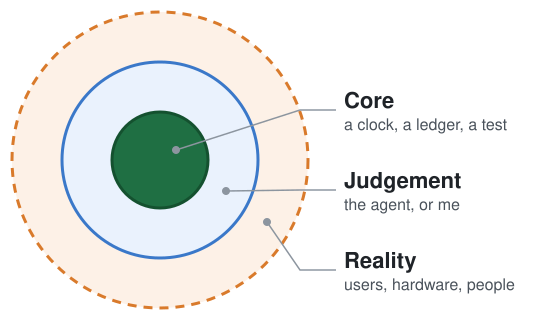
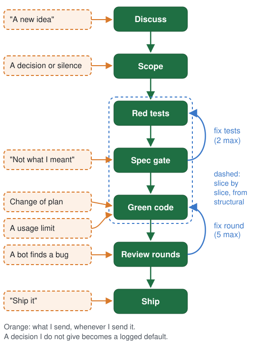
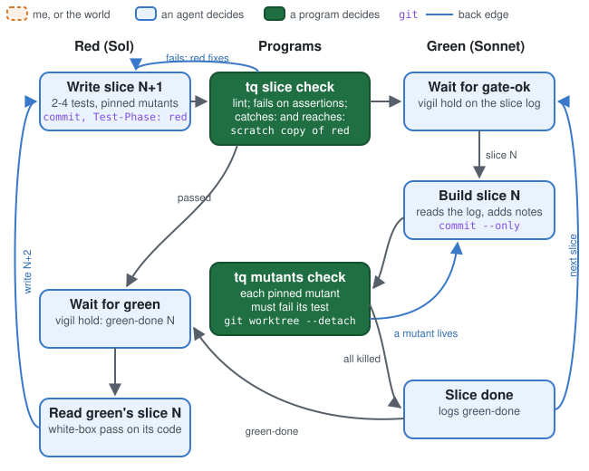
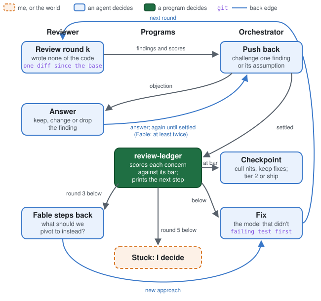
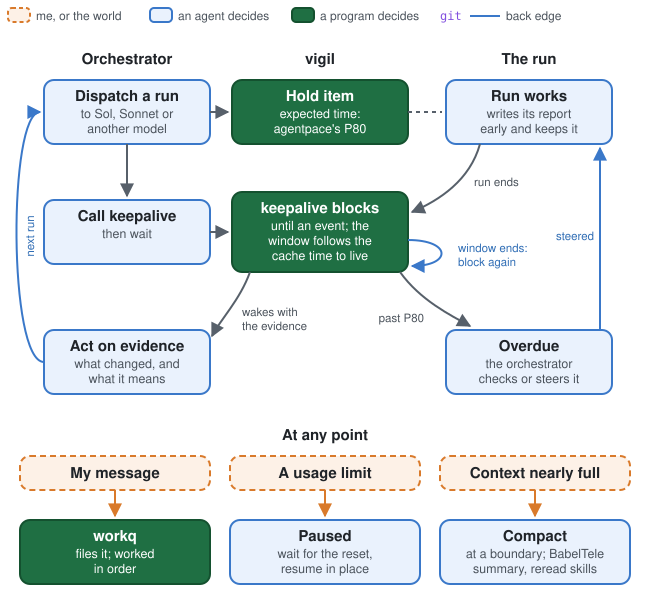
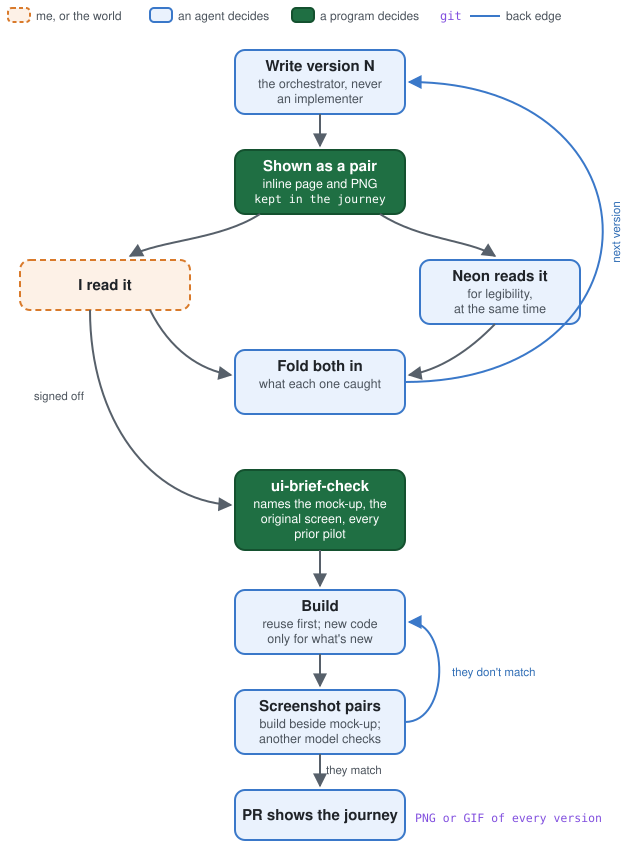
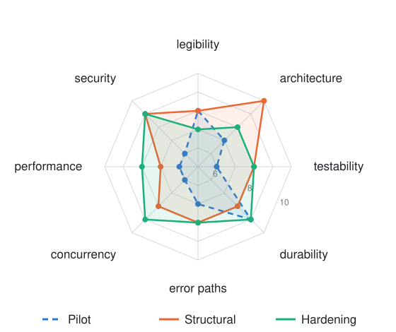
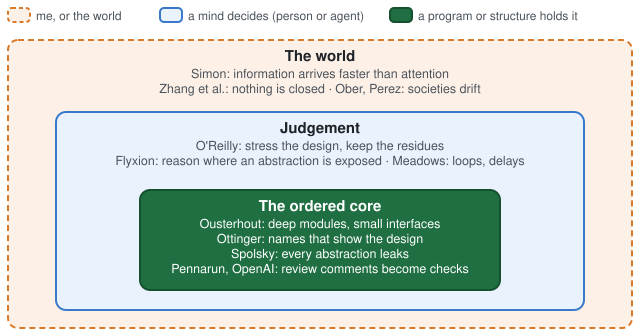

# mstack

The skills, helper scripts and research I use to work with coding agents.

mstack is the source for my agent skills and global instructions. The skills are written for my own tools, hosts and habits, so adapt them before you use them. The research keeps dated observations and grades every claim from A (a controlled study) to D (opinion); start with a skill you need, or with the [research index](research/00-index.md) for the evidence and its limits. The original 2026-11-12 snapshot is the v0.1.0 release. Agents working in this repository should read [AGENTS.md](AGENTS.md) instead of this page.

## How I work with agents

People call agent work more art than science. I read that as science nobody has worked out yet, so I keep measuring. Two ideas run through everything here: make the state of things **legible**, and keep my own **mastery** of code I did not type. The reading behind both is in [Influences](docs/influences.md).

### Legibility: a solid core, a soft edge

<p align="center"></p>

| Ring | What it does |
|---|---|
| Core: a clock, a ledger, a test, a measurement | Shows the agent, or me, where things stand. Fast and exact. |
| Judgement: the agent, or me | Reads the core and decides. This is where inference earns its cost. |
| Reality: users, hardware, other people | Surprises us, and each surprise feeds back into a better core. |

The picture is a twist on the core model of Barry O'Reilly's [residuality theory](https://doi.org/10.1016/j.procs.2020.03.120) (my notes: [research 18](research/18-girba-wayne-oreilly.md)), where ordered software sits inside a complex business, which sits inside a disordered world. Here the middle ring is judgement, and the ordered core exists to show that judgement the state of things.

Code alone is fast but cannot adapt. Inference alone adapts but is slow and imprecise. It is also a twist on Rich Sutton's [bitter lesson](http://www.incompleteideas.net/IncIdeas/BitterLesson.html): more compute keeps improving the models, but anyone, human or model, who cannot see the state still guesses. So I look for guesses a program could replace. Each core below started as something agents kept guessing at.

<details><summary><b>How long a wait takes: vigil</b></summary>

An agent waiting on a build used to sleep four and a half minutes, wake, learn nothing and sleep again, and when one link in that chain broke the session went quiet and its prompt cache expired. [vigil](https://github.com/mikenrafter/vigil) replaces the sleep with one call that blocks until something it watches changes: a process ends, a file appears, a log line matches, or a small judge model decides that a log shows a failed build. The agent wakes with the evidence instead of a bare "keepalive". Watching this way also exposed a harness that cut MCP calls off at 180 seconds, which no agent had noticed.

</details>

<details><summary><b>When the work will be done: agentpace</b></summary>

[agentpace](https://github.com/mikenrafter/agentpace) answers "how long will this take?" from measured agent runs, as a P50, P80 and P90 range, with the human part (review, testing, decisions) on its own line. My fork adds plan state and reads vigil's ledger, so every finished wait becomes a timing. It is not accurate yet: this week all 8 of its estimates ran 4 to 25 times too long. The difference is that the error is now a number I can watch shrink.

</details>

<details><summary><b>Whether a test proves anything: tq</b></summary>

Agents write tests that pass whatever the code does. [tq](#testquest) is a linter for those hollow tests. Each rule is scored on 30 public repos, with a model judging samples of its findings, and the [testquest section](#testquest) says how a score decides whether a rule blocks.

</details>

<details><summary><b>Which findings are real: a separate judge</b></summary>

When the model that wrote a rule also graded its findings, it was too generous with its own output. A model that wrote none of the rules now judges them, and its verdicts go into a cache keyed by the exact code it read. A rule change is then scored against the same answers, and no verdict is guessed twice.

</details>

<details><summary><b>How the system fails: residual</b></summary>

[residual](https://github.com/mikenrafter/residual) is Barry O'Reilly's residuality theory as a command-line tool. The agent and I walk the codebase under stress, and residual records the recurring states it falls into (attractors) and the small changes that let it survive them (residues) as project data the agent can check, instead of a risk list rebuilt from memory each session.

</details>

<details><summary><b>How the code is shaped: paneweft</b></summary>

[paneweft](https://github.com/mikenrafter/paneweft) brings views from Glamorous Toolkit's moldable development into any codebase. An agent fills a view with facts about the code, I read it in a browser, and the agent reads the same view back as bounded text. The views live inside the code they explain, so when the code changes, a view that no longer fits shows up instead of a hand-drawn diagram going quietly stale.

</details>

<details><summary><b>Whether a layout shifts: a layout-shift score</b></summary>

UI stability used to be judged by eye from screenshots. The browser's own layout-shift score (CLS) replaced that, and on a UI pilot it is one of the four scored concerns.

</details>

When a guess is big enough to build a company on, the [legible-cores](skills/legible-cores/SKILL.md) skill has the agent raise it with me as one card.

### Mastery: keep up with code I did not type

Agents write most of the code, and I still have to own it. These are the habits that keep me able to:

| Habit | What it does | Status |
|---|---|---|
| Review check | Every pull request ends with ten questions; if I answer 24 of 30 points correctly, I have reviewed it | In use ([pr-stacks](skills/pr-stacks/SKILL.md)) |
| Journey file | Each feature keeps its mock-ups, my decisions and its dead ends, because the paths I dropped explain the one I took | In use ([build-loop](skills/build-loop/SKILL.md)) |
| Question first | An interview on states, edges and precedence before any spec | In use ([question-everything](skills/question-everything/SKILL.md)) |
| Sliced red and green | One model writes a few failing tests and the mutants they must kill; a different model writes the code. Each slice has one real flip, not just "delete the button" | In use since 2026-11-27 ([build-loop](skills/build-loop/references/slices.md)) |
| Views that teach | A benchmark for whether a view makes a fresh agent understand the code better than reading it | Proposed ([research 13](research/13-research-direction-views-that-teach.md)) |

<details><summary><b>Views that produce insight</b></summary>

Views of the code should produce insight. A component earns its place by answering a question the reader would otherwise guess at, and decoration gets cut. I want views to make tests, invariants and their coverage visible, so that a wrong change looks wrong. [paneweft](https://github.com/mikenrafter/paneweft) is where I try this, starting from the moldable development ideas in [Glamorous Toolkit](https://gtoolkit.com/). Short lessons at build-loop phase boundaries are still planned.

</details>

<details><summary><b>Pictures carry more than prose</b></summary>

This README leans on diagrams for the same reason the loop leans on mock-ups: a picture carries more at once than text. A state machine, a radar of bars or a mock-up shows in one look what takes paragraphs to say, and a wrong change looks wrong. Agents now draw these well, but a picture made once and thrown away has to be paid for again next time. [paneweft](https://github.com/mikenrafter/paneweft) keeps views inside the code they explain, so they are saved, reused and checked when the code changes, and drawing stays cheap over time.

</details>

### The build loop: a fixed path, unpredictable input

Every feature runs through the same state machine ([build-loop](skills/build-loop/SKILL.md)). The diagram is one stage; each card below opens one part of it, with its own diagram.

<p align="center"></p>

My input is the chaotic part: a new idea, a change of plan or "not what I meant" can arrive in any state, and the loop takes it where it lands.

<details><summary><b>Why each state is there</b></summary>

Discussion opens with a recommendation: what the agent thinks we are building, the design it would build, the strongest objection and a simpler alternative. Its questions come numbered with recommended answers, so most take a word; one I leave open becomes a logged default.

Scoping fixes one base commit and one diff, so every reviewer reads the same change, and [agentpace](https://github.com/mikenrafter/agentpace) turns it into a plan with a committed time, a median and a P80.

Red comes before green so the tests state the contract before any code can agree with them. At the spec gate, a model that wrote neither the spec nor the tests tries to write wrong code that still passes; each success is a missing test.

Every state's work is committed before the next begins, so the session can stop anywhere and resume in place.

</details>

<details><summary><b>Red and green, slice by slice</b></summary>

<p align="center"></p>

From the structural stage on, red and green run at once: green builds slice N while red writes N+1. Programs referee. `tq slice check` passes red's tests only if each fails on an assertion and names the wrong code it catches; `tq mutants check` passes green's code only if each named wrong version fails its test. Red stays at most one slice ahead, so its tests fit the code actually built. About five minutes into each slice the orchestrator pushes on a point or two, never on what the programs settled. Only one of the pair is a Claude model, so the two run in parallel under my cap of one working Claude agent, and at every cut the loop asks what stops more of the work running in parallel.

</details>

<details><summary><b>Review rounds, and how they argue</b></summary>

<p align="center"></p>

Review is where most of the cost goes, so it has hard limits. A model that wrote none of the code sends findings and scores. The orchestrator challenges at least one finding or the assumption behind it, and the reviewer keeps, changes or drops it until it is settled; Fable gets two such exchanges. Every finding has to survive a challenge before a fix is spent on it.

review-ledger then scores each concern against the stage's bar and prints the next step. Below the bar, the model that did not write the last fix writes the next one, failing test first. A failed round 3 asks Fable for a pivot, not more fixes; after round 5, I decide.

A pilot gets round 1, then Fable, then my thumbs-up, against the four or so bars we agreed. Structural and hardening run all five rounds, hardening against production bars and a threat model.

</details>

<details><summary><b>Waiting without burning turns</b></summary>

<p align="center"></p>

Every delegated run is an item on one [vigil](https://github.com/mikenrafter/vigil) hold, expected to take agentpace's P80; past it, the orchestrator checks on the run. keepalive blocks until something changes, with its window matched to the prompt cache (up to 50 minutes on a one-hour cache, 4.5 on a five-minute one), so no wait lets the cache expire. Messages I send mid-run go into workq and are worked in order. The agent compacts at a phase boundary it chooses, writes the summary in BabelTele, a dense notation any model reads without a codebook, and rereads its skills afterwards.

</details>

<details><summary><b>Mock-ups</b></summary>

<p align="center"></p>

UI work stands or falls on the mock-up, so the orchestrator writes every version itself. I see each one inline and as a PNG while Gemini Neon reads it for legibility, since we catch different things, and both feed the next version. After sign-off, `ui-brief-check` fails a build brief that does not name the mock-up, the original screen and every earlier pilot, because an implementer once rebuilt parts the app already had. The build is compared with the mock-up in screenshot pairs, and the pull request shows every version.

</details>

### Review bars follow the project

<p align="center"></p>

A bar fixed for a project's whole life does damage: one of my tools spent eight review rounds on concurrency races that no real user would hit for a long time, while it was still a prototype. So each concern gets its own bar, set by the stage. The chart is an example feature that writes the user's data.

<details><summary><b>The numbers, and why they move</b></summary>

| Concern | Pilot | Structural | Hardening |
|---|---|---|---|
| Legibility | 8 | 8 | 7 |
| Architecture | 7 | 10 | 8 |
| Testability | 6 | 8 | 8 |
| Durability | 9 | 8 | 9 |
| Error paths | 7 | 8 | 8 |
| Concurrency | 6 | 8 | 9 |
| Performance | 6 | 7 | 8 |
| Security | 6 | 9 | 9 |

A pilot is scored only on the few concerns I agree to up front; everything else waits in a hardening list. The structural round peaks on architecture, because it gets expensive to change after that. Hardening, before a release, raises concurrency, durability and performance. Maturity is judged per region of the code, and I can override what the tool computes. Security comes from a written threat model for each project (who can reach it, what strangers can feed it, what it holds), and findings are weighed against that model; two agents sending the same request in the same millisecond goes on the hardening list.

</details>

### Testing practices against what really happened

<details><summary><b>Replaying real bugs against a practice</b></summary>

I want to test practices against things that happened. The plan is to take real bugs, reverts and decisions I later undid in my own repositories, hide how each one ended, and see whether a given prompt, skill or piece of advice from a well-known practitioner leads an agent to the good outcome. [testquest](#testquest) is the first small step.

</details>

### What changed my mind lately

<details><summary><b>Five findings, and where each one lives now</b></summary>

| Finding | Where it lives now |
|---|---|
| A broken run can come out as a good score: a failed build counts every mutant as killed ([Robert C. Martin's mutator](https://github.com/unclebob/mutator/pull/39)), a dropped exit status reads as a pass ([Matt Pocock](https://github.com/mattpocock/skills/pull/1479)) | test-quality failure mode 14 |
| A check that cannot run must fail, and every gate gets watched failing once before it is trusted | [ratchets](skills/ratchets/SKILL.md) |
| A rule's precision differs a lot by language, so each rule blocks or only warns per language, decided by a vote of repos with enough judged findings | [testquest](#testquest) gates, being measured |
| Reading a new rule back to three fresh agents finds wording they would misread ([Matt Pocock](https://github.com/mattpocock/skills/pull/1474)) | a pilot over ten skill edits |
| A row of substring checks over one text hides drift; one golden of the whole text does not | test-quality failure mode 13 |

</details>

### Cost against quality

I work under two limits, money and my own attention, and I would rather measure the trade than argue it. Cost is tokens against each provider's usage windows (tracked by [usagewindow](https://github.com/mikenrafter/usagewindow)) and cloud sandbox hours. Quality is what judged samples and scored review rounds say.

<details><summary><b>What I measure, and what it showed</b></summary>

| Question | How I measure it | What it showed |
|---|---|---|
| Where do the tokens go? | 504 of my transcripts, 50,563 API calls ([research 06](research/06-usage-claude.md)) | Keepalive ticks drove about a quarter of estimated Claude cost, and subagents half. So vigil replaced the ticks, and one working Claude agent runs at a time. |
| Does another review round pay? | 39 labeled later rounds across six projects ([review-budget report](research/elo-code-health/review-budget/REPORT.md)) | No rating model beat a simple baseline at predicting whether one more round finds something, so rounds stop on scores against the bars, not on a formula. |
| Which model for which job? | Head-to-head runs on the same brief, logged per model | On one port, Hydrogen and Sonnet kept every real finding; Hydrogen was faster and wrote twice the code. Cheaper models implement, and Opus judges samples. |
| How long will this take? | [agentpace](https://github.com/mikenrafter/agentpace) estimates against actual run times | This week only 8 of 373 runs had an estimate, and all 8 were 4 to 25 times too high. Still open. |
| Is a finding real? | A separate model judges samples; precision per rule and language | See [testquest](#testquest). |

When one provider's window runs low, work moves to another, and heavy builds go to cloud sandboxes instead of my 8 GB hosts. What I cannot yet do is put cost and quality on one axis: nothing here measures escaped defects. Agents need my approval before they open issues, forks, pull requests or posts.

</details>

## testquest

[testquest](https://github.com/mikenrafter/testquest) gives me `tq`, a linter for hollow tests: tests that pass even when the code they test is broken. Agents write a lot of those, because a green test looks like progress. tq reads the tests, not the code, on an [ast-grep](https://ast-grep.github.io/) engine for Python, Rust, TypeScript, Dart, Kotlin and Java.

<details><summary><b>The rules</b></summary>

| Rule | Flags a test that |
|---|---|
| `no-assert` | runs code but never checks a result |
| `guarded-assert` | only checks inside a branch the test can skip |
| `absence-no-control` | checks that nothing was recorded, but never shows the recorder can record |
| `self-compare` | compares a value with itself |
| `const-truth` | checks values the test fixed itself, with no product code between |

Those five can fail a build. Advisories only point things out: a row of substring checks over one text (`micro-snapshot`), a test whose only claim is not crashing (`no-crash`), an expected value read back from the code's own output (`self-derived-expected`), and a few more. For the sliced build loop, `tq slice check` and `tq mutants check` verify that each slice's tests fail on an assertion and kill their pinned mutants, and that at least one mutant changes real logic rather than deleting a button.

</details>

<details><summary><b>How every rule is measured</b></summary>

A linter that cries wolf gets ignored, so every rule is measured. It runs over my own repos and over 30 public ones, five per language; a separate model judges samples of what it finds as real, intended or false; and the share that is real decides the rule's fate per language. A rule blocks unless repos where under 15% of its findings are real outnumber the rest two to one, counting only repos with at least eight judged findings. Below that it only warns. In the latest rounds, a second model cut the judged-false findings in a Java and Python sample from 61 to 5 without losing a real one.

</details>

The ast-grep engine, the measurements and the gates are on a branch; testquest's main branch still has the older engine, and the release is pending.

## Skills

Clone the repository and ask your agent to read the `SKILL.md` you need and the files it points to:

```sh
git clone https://github.com/mikenrafter/mstack.git
```

Skills come in sets of three that run together:

| If you want to | Use these together |
|---|---|
| Build a feature with agents, from first question to merged code | [question-everything](skills/question-everything/SKILL.md), [build-loop](skills/build-loop/SKILL.md), [test-quality](skills/test-quality/SKILL.md) |
| Stop agents guessing, and learn from each week | [legible-cores](skills/legible-cores/SKILL.md), [retro](skills/retro/SKILL.md), [practice-watch](skills/practice-watch/SKILL.md) |
| Review a design and ship it in small pieces | [technical-excellence](skills/technical-excellence/SKILL.md), [deliberate-changes](skills/deliberate-changes/SKILL.md), [pr-stacks](skills/pr-stacks/SKILL.md) |
| Make a lesson stick so it never comes back | [ratchets](skills/ratchets/SKILL.md), [adaptive-hardening](skills/adaptive-hardening/SKILL.md), [comment-audit](skills/comment-audit/SKILL.md) |
| Write for people | [plain-writing](skills/plain-writing/SKILL.md), [unslop](skills/unslop/SKILL.md), [writing-copy](skills/writing-copy/SKILL.md) |
| Publish without leaking or overstepping | [readme](skills/readme/SKILL.md), [publishing-scrub](skills/publishing-scrub/SKILL.md), [no-unsolicited-upstream](skills/no-unsolicited-upstream/SKILL.md) |
| Wait for long work without burning budget | [vigil](skills/vigil/SKILL.md), [uw-agent](skills/uw-agent/SKILL.md), [manual-keepalive](skills/manual-keepalive/SKILL.md) |
| Run builds on my hosts | [boat](skills/boat/SKILL.md), [low-ram-hosts](skills/low-ram-hosts/SKILL.md), [iterating-with-nix](skills/iterating-with-nix/SKILL.md) |

<details><summary><b>The other skills, and how to install one</b></summary>

The rest are single tools for my setup: [scout-module-locks](skills/scout-module-locks/SKILL.md), [tea](skills/tea/SKILL.md), [tailcook](skills/tailcook/SKILL.md), [github-stars](skills/github-stars/SKILL.md), [cyber-build-loop](skills/cyber-build-loop/SKILL.md) (clean-room reverse engineering, built from the build-loop insights that apply to it) and [handling-ambiguous-work](skills/handling-ambiguous-work/SKILL.md) (recovering a thread after a provider error).

Copy a whole skill directory when you install one; `build-loop` needs its `references/` and `scripts/`, and the companion skills a skill names must be installed too. Installation paths and tool names vary by agent. The host and tool skills describe my environment, and reading them does not install those tools.

</details>

## Limits

The research covers one person on one host. Nothing in it measures escaped defects, production impact or what I learned. The tq precision numbers come from a model judging samples of findings, not from people. Several habits above are pilots, and their status says so.

## Research

[research/00-index.md](research/00-index.md) starts the literature review and the analysis of my own agent usage.

<details><summary><b>What else is there</b></summary>

Raw transcripts and private usage data are left out; citations to them are marked as private. [RELEASE.md](RELEASE.md) lists publication checks and open questions, [research/PLAN.md](research/PLAN.md) the dated plan, and [related.md](related.md) the neighboring tools. `research/site/index.html` is an optional reader for sections 00 to 09; it fetches the Markdown files and outside rendering libraries, so it needs HTTP hosting. The Markdown files are the main way to read it.

</details>

## Influences

Much of how I build comes from what I read, and most of it carries no engineering label. [docs/influences.md](docs/influences.md) collects the sources from my Readwise library that shaped this work most, in three groups: systems that persist (residuality, deep modules, systems thinking, legibility), learning and mastery (deliberate practice, memory, flow, reading widely), and people and agents (interfaces, alarms, assistants, trust). Each section opens with diagrams of how the ideas fit; each source is one line that opens to why it matters, my notes on it and passages I highlighted. Every source is linked, and the originals are worth reading in full.

<p align="center"></p>

## For agents and contributors

[AGENTS.md](AGENTS.md) covers editing and installing skills, the helper scripts and their tests, and the rules for publishing.

## License

[MIT](LICENSE), copyright 2026 Tyler Slaughter. The license covers original material in this repository. Cited publications and third-party material keep their own rights.
