# Influences

These are the sources in my Readwise library that shape how I think about engineering, learning and the work between people and agents. I read polymathically, so plenty of them carry no engineering label; they are here because they changed how I build.

> I'd rather write books for 10,000 people who are genuinely changed by them than crank out short-form videos for 10 million people who forget about them within days or minutes.
>
> Tim Ferriss, ["Has AI Already Killed How-to Nonfiction?"](https://tim.blog/2026/06/12/has-ai-already-killed-nonfiction/) (2026)

Ferriss sent friends a handful of bullet points from *The 4-Hour Body*; none of them acted on it, while thousands of readers who followed the whole book did. This page is the bullet points. Read the originals: every source below links to where you can find it, and **the journey through a full book or essay is what changes how you work.**

Each section opens with the positions I hold and a few diagrams of how the ideas fit. Then each source is one line; open it for why it matters, some of my notes on it, and passages I highlighted. Books are named by author, title and the published edition I know of; web pieces link to the author's own page. Nothing here links to a copy of a copyrighted text. Obvious typos and scan errors are corrected.

1. [Systems that persist](#systems-that-persist): architecture, abstraction, legibility, review, and systems outside software.
2. [Learning and mastery](#learning-and-mastery): deliberate practice, memory, flow and reading widely.
3. [People and agents](#people-and-agents): interfaces, alarms, assistants and trust.

## Systems that persist

Software is the engineering of systems that live inside an organization that lives inside a disordered world. These sources shape how I give such a system a solid core and let it adapt flexibly over time.

Traditional engineering is a wide category, and it does not transfer as a whole. What carries over depends on the time constraints a discipline works under and the shape of its tests. CAD carries over better than most because it has specific shapes of test that help: a part is fully constrained or it is not. Software has nothing as complete, so tests, comments, types and views all have to work together.

Parallel agents are not an army. I do not swarm. The build loop is a deliberate flow of information: each agent gets a narrow brief, a program checks what it hands back, and the next step reads from that.

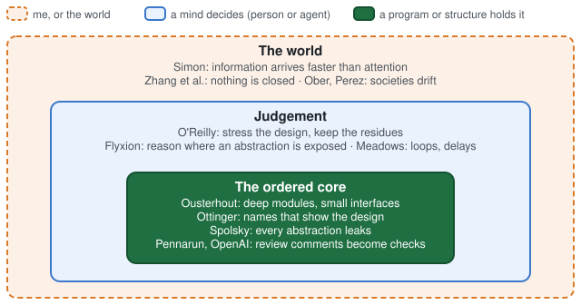

### Software and its architecture

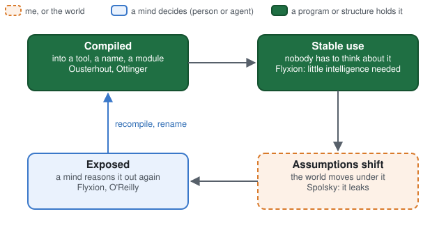

<b>Residues and The Architect's Paradox, Barry O'Reilly</b>: residuality theory, the base of residual

**Barry M. O'Reilly: [*Residues: Time, Change, and Uncertainty in Software Architecture*](https://leanpub.com/residuality) (Leanpub, 2024); [*The Architect's Paradox: Uncertainty and the Philosophy of Software Architecture*](https://leanpub.com/architectsparadox) (Leanpub, 2025); ["The Path to Residuality Theory"](https://www.cutter.com/sites/default/files/APM/2021/The%20Path%20to%20Residuality%20Theory%20Collection.pdf) (Cutter Consortium, 2021); "Residuality and Representation: Toward a Coherent Philosophy of Software Architecture" ([his publications](https://www.open.ac.uk/people/node/55536))**

Residuality theory is the base of [residual](https://github.com/mikenrafter/residual) and of the core-and-edge picture in the README. My own definition of a residue, written after finishing *Residues*: the foundational unit for observing how an architecture responds to stressors in its environment, a scale- and probability-independent slice of the state space. An affordance for a residue need not be a full implementation; a thoughtful module boundary is often enough.

*From my notes*

> A residue is the foundational unit for observing how system architecture responds to stressors in an environment. It is a scale and probability independent slice of the state space comprising the conditions that lead to it, how the various peripheral pieces of the system will react and the changes made to the naïve system (see definition below) in order to offset the drawbacks of the various attractors its many stressors provoke.

> An important thing to note is that affordances made for residues need not be full or complete implementations in order for them to bring value. Thoughtful module decomposition boundaries typically prove sufficient affordances for designs that are not immediately viable for one reason or another.

> A naïve system is one designed without consideration of the residue it is naïve to. A system is naïve to particular residues. The naiveté of a system is not an intrinsic property.

> Constant scalars must not be mistaken for stability. It is instead adaptability, which is at the heart of persistence.

> A helpful reminder here is the true scope of an interface: the documentation, code organization, state machine, errors, comments, historical changes, coupling, tests, visibility mechanisms, mechanism of language and of course the language-defined interface are all part of what really constitutes an interface.

*Quotes from the source*

> Residuality is the belief that software systems should be thought of as a collection of residues. A residue is what is left over when the software system is stressed.

> The goal of the architect is criticality, not correctness.

> There is a big difference between criticality and correctness. A system which is critical is necessary in any complex environment, but correctness is not achievable or even desirable.

> Residuality involves the survival of a system as the environment and the system move between different attractors.

> Considering a hyperliminal system as an undifferentiated complex adaptive system incurs the same risk as agile approaches where the technical quality of the system can be lowered because of an assumption that the adaptive human part can cover the slack.

> The separation of stressors from solutions provides a feeling of objectivity, where all proposed solutions are exposed to the same stressor list, and thus there is a feeling of fairness rather than of being attacked.

> Instead of representing static entities, residuality represents differences and flux. ... To represent the entire residual stack is never possible, but small glimpses of it are enough to trigger the journey toward criticality.

> The point of this kind of matrix is initially to represent the relationship between the stressors/attractors and components and provide visual triggers to refactoring before we commit to a specific design.

> Hegel gives us hope that the constant churn we experience when developing our conceptual models and code isn't our own incompetence, but it simply is how things are meant to be.

<b>A Philosophy of Software Design, John Ousterhout</b>: deep modules; comments and constraints together

**John Ousterhout: [*A Philosophy of Software Design*](https://web.stanford.edu/~ouster/cgi-bin/book.php), 2nd ed. (Yaknyam Press, 2021), and [his discussion with Robert Martin](https://github.com/johnousterhout/aposd-vs-clean-code)**

Deep modules and information hiding are how I judge an abstraction, and an interface is more than its signature: it includes the documentation, the errors, the tests, the history and the coupling. From the debate with Martin I took that comments and constraints are not either-or. Assertions keep comments from going stale; comments carry what code cannot say.

*From my notes*

> Code-enforced assertions complement well written comments, but they do not replace them. Code-enforced assertions help to keep comments from becoming stale and provide cross-verifiability.

> CAD has something to teach software engineering. If you want your code to work with assurance - you must fully constrain it. Interfaces and type systems do not cut it. Tests are a step in the right direction, but even they do not cut it.

> Comments AND constraints. It is not either or.

> That is literally the definition of your own bias. Your code should be legible aside from your bias!

*Quotes from the source*

> Complexity is anything related to the structure of a software system that makes it hard to understand and modify the system.

> the greatest limitation in writing software is our ability to understand the systems we are creating.

> In general, if a developer needs to know a particular piece of information in order to use a module, then that information is part of the module's interface.

> think about the different pieces of knowledge that are needed to carry out the tasks of your application, and design each module to encapsulate one or a few of those pieces of knowledge.

> Things that are not important should be hidden, and the more of them the better. But when something is important, it must be exposed.

> When developing a module, look for opportunities to take a little bit of extra suffering upon yourself in order to reduce the suffering of your users.

> Sometimes an approach that requires more lines of code is actually simpler, because it reduces cognitive load.

> If it's hard to find a simple name for a variable or method that creates a clear image of the underlying object, that's a hint that the underlying object may not have a clean design.

> The guiding principle for comments is that comments should describe things that aren't obvious from the code.

> one of my favorite sayings: "code that hasn't been executed doesn't work"

> The incremental approach works for software because software is malleable enough to allow significant design changes partway through implementation.

> Beautiful designs reflect a balance between competing ideas and approaches.

> If there is one thing more likely to result in bugs than not understanding code, it's thinking you understand it when you don't.

> If two pieces of code are tightly related, the solution is to bring them together.

<b>The Law of Leaky Abstractions, Joel Spolsky</b>: every abstraction leaks

**Joel Spolsky: ["The Law of Leaky Abstractions"](https://www.joelonsoftware.com/2002/11/11/the-law-of-leaky-abstractions/) (2002)**

Abstraction is part of the fight against entropy, and every one of them leaks. A tool that hides a layer still owes its user a way to see that layer when it breaks.

*From my notes*

> Even so, I'm still in favor of learning mechanism, but to say that abstraction doesn't save time in learning, I think is incorrect. It doesn't save time for the power user, but it saves time for everyone else. The power user is the edge case in many scenarios. (unfortunately)

*Quotes from the source*

> So the abstractions save us time working, but they don't save us time learning.

> The abstraction leaks, though. ... if the programmer doesn't understand what ASP.NET was abstracting away, they simply won't have any clue what is wrong.

> Indeed, the abstractions we've created over the years *do* allow us to deal with new orders of complexity in software development that we didn't have to deal with ten or fifteen years ago

<b>A Short Guide to Naming, Tim Ottinger</b>: a hard name points at an unfinished design

**Tim Ottinger: [*A Short Guide to Naming*](https://leanpub.com/naming_shortguide) (Leanpub, 2026)**

Naming is where design shows first. A name that is hard to find points at a design that is not done, and an honest placeholder beats a vague one.

*Quotes from the source*

> If you can't give an item a good name, give it a terrible one.

> I feel it's more transparent to have a bad name that is clearly and intentionally bad, whereas `data` or `info` or (worse) `customerInfo` doesn't really stand out as a temporary name.

> **Consider the caller's perspective** - What would make sense to someone using this function or class?

> **Complex expressions** - If a conditional or calculation requires mental parsing, extract and name it.

> My goal isn't to hide implications, but to make the code in context as obvious as it possibly can be, and let the tools and syntax handle the rest.

> Seeing many different ways to express an idea is good for you and your team, as it may profit you many new ways of understanding and writing code.

<b>Thinking in Systems, Donella Meadows</b>: stocks, flows, delays; pictures over words

**Donella H. Meadows: [*Thinking in Systems: A Primer*](https://en.wikipedia.org/wiki/Thinking_In_Systems:_A_Primer), ed. Diana Wright (Chelsea Green, 2008)**

Stocks, flows, delays and feedback loops are the vocabulary I use for anything that runs over time, from a review queue to a usage window. Meadows also gave me the case for pictures: words arrive one at a time and a system does not. That is why the README draws its loops. And from the blind men and the elephant: static analysis alone is not enough to understand a system.

*From my notes*

> Static analysis alone is not sufficient to comprehend the system.

> This is a really good way to structure an introduction to something. Additionally, I find it beneficial to describe your process like this. It gives a structure for the reader to hang the ideas that you describe upon, and it helps to quiet the "but what about ..." questions that naturally arise over the course of learning.

> Has a person truly learned if their mechanisms remain unchanged?

*Quotes from the source*

> Words and sentences must, by necessity, come only one at a time in linear, logical order. Systems happen all at once.

> Pictures work for this language better than words, because you can see all the parts of a picture at once.

> It's easier to learn about a system's elements than about its interconnections.

> A change in purpose changes a system profoundly, even if every element and interconnection remains the same.

> A system generally goes on being itself, changing only slowly if at all, even with complete substitutions of its elements, as long as its interconnections and purposes remain intact.

> Delays are pervasive in systems, and they are strong determinants of behavior.

> When there are long delays in feedback loops, some sort of foresight is essential. To act only when a problem becomes obvious is to miss an important opportunity to solve the problem.

> The information delivered by a feedback loop, even nonphysical feedback, can only affect future behavior; it can't deliver a signal fast enough to correct behavior that drove the current feedback.

> Stocks generally change slowly, even when the flows into or out of them change suddenly. Therefore, stocks act as delays or buffers or shock absorbers in systems.

> When a subsystem's goals dominate at the expense of the total system's goals, the resulting behavior is called suboptimization.

> Systems need to be managed not only for productivity or stability, they also need to be managed for resilience.

> Hierarchical systems evolve from the bottom up. The purpose of the upper layers of the hierarchy is to serve the purposes of the lower layers.

<b>Designing Organizations for an Information-Rich World, Herbert Simon et al.</b>: attention is the scarce resource

**Herbert A. Simon, Karl W. Deutsch, Martin Shubik and Emilio Q. Daddario: "Designing Organizations for an Information-Rich World", in [*Computers, Communications, and the Public Interest*](https://ci.nii.ac.jp/ncid/BA03513286?l=en), ed. Martin Greenberger (Johns Hopkins Press, 1971)**

Attention is the scarce resource, not information. The answer Simon gives is to educate people to turn data into better information; mine adds tools that make meaning easier to tease from data. That is the legible-cores idea, fifty years early.

*From my notes*

> And in providing tools that make meaning easier to tease from data.

> Armchair speculations, especially by the polymath are not useless.

> We have these tools now. Knowledge graphs, NLPs, LLMs and constitutions defining values.

*Quotes from the source*

> The bulk of information that enters a system from the environment is irrelevant to action at the time of entry. Much of it will never be relevant, but we cannot be sure in advance which part this is.

> But unorganized data are not knowledge, and modern communications contain the potential to confuse as well as educate.

> The answers lie more in educating man to process data into better and more relevant information than in shaving microseconds off processing times.

> Less wise men run the danger of confusing their lack of understanding of the ever-mounting volume of data with being better informed.

> The more powerful an operation, the more foresight becomes necessary to avoid fatal damage. The faster an automobile, the farther ahead must its headlights cast their beam.

> If we are to understand information processing, we must study it in the laboratory of nature. We must construct, program, and operate many kinds of information-processing systems to see what they do and how they perform.

> I would like to suggest that our organizations and many of our activities be looked at as experiments.

> When it affects my personal safety, I want computers to make all decisions they can make better than men.

> A key unsolved problem is how to measure the contextual or semantic information content of a message in a social system.

<b>Noun-Free Cognition, Flyxion</b>: difficulty is a relation; intelligence works at exposed abstractions

**Flyxion: ["Noun-Free Cognition: Difficulty, Abstraction, and the Mobility of Computation"](https://standardgalactic.github.io/research-projects/Noun-Free%20Cognition.pdf)**

Difficulty is a relation, not a property of a task. When everything stays inside expected parameters, precompiled models carry the work and little intelligence is needed; intelligence is what is needed in the exposed abstraction moments. That is the split between the ordered core and the soft edge.

*From my notes*

> Intelligence is what allows for adaptability in these exposed abstraction moments. When everything is rote, resolved, and within expected parameters, there is little intelligence needed. Operation continues smoothly, the precomputed models work as expected. But when parameters shift to unhandled regions, some form of intelligence is required to formulate structure around the exposed abstraction.

> I intuitively have this understanding already but other people may not have such a realization and additionally the formalization of such a concept perhaps will provide useful insight

*Quotes from the source*

> The central thesis of this paper is that difficulty is not a noun but a relation.

> As a result, abstraction is inherently provisional. The interfaces it produces are only reliable so long as the environmental assumptions that underwrote their compilation remain approximately valid. When those assumptions fail, the abstraction must be dismantled, and its internal structure re-exposed to active reasoning.

> A task becomes easy not because its combinatorics have vanished, but because they have been absorbed into a substrate that is no longer interrogated.

> Formalizations arise as retrospective summaries of stabilized use. They are useful so long as the practices they summarize remain intact, and they fail when those practices shift.

> Expertise consists in mastery of existing compilations, not foresight into their obsolescence.

> As soon as a measure becomes salient, it becomes a target for optimization, and its classificatory power erodes.

### Legibility and review

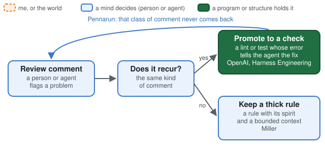

<b>Legibility Is Ruining You, Jimmy Miller</b>: legibility is fine; process cut off from value is not

**Jimmy Miller: ["Legibility Is Ruining You"](https://jimmyhmiller.com/legibility-is-ruining-you)**

I disagree with the title and keep the essay. The trouble is not legible process; it is process divorced from the value it was meant to serve. As skill grows you learn to articulate it, and that makes you better at the work and at teaching it. A rule needs a spirit as well as a mechanism, and a bounded context. The true master can articulate their skill and process, though not everyone who can articulate a process is a master.

*From my notes*

> It's not the legibility of the process, but rather the divorcing of the process from the true value that's the issue. When you gain a new skill, at first, you typically aren't able to articulate every nuance of it well. But as time goes on, you gain more skill, you acquire further insight into your own psyche and you're able to convert it into a legible version of that same process. In so doing, you're not only able to operate better, but you're able to teach others better.

> What if instead it's about the rules having bounded contexts and answers on a spectrum? Where the rule has a spirit and not just a mechanism.

> The true master is one who is able to articulate his skill and process, though not all those who can articulate their skill and process are true masters.

*Quotes from the source*

> "Did the code pass code review?" is the wrong question. How much bad code have you seen pass code review?

> Thin rules are the algorithmic, mechanistic rules we in software favor; they are rules that can be obeyed and enforced unambiguously. Thick rules, on the other hand, are rules of thumb; they are guiding principles.

> They constantly try to escape / From the darkness outside and within / By dreaming of systems so perfect that no one will need to be good. (T. S. Eliot, quoted by Miller)

<b>Every Layer of Review Makes You 10x Slower, Avery Pennarun</b>: a recurring review comment should become a check

**Avery Pennarun: ["Every Layer of Review Makes You 10x Slower"](https://apenwarr.ca/log/20260316) (2026)**

A review comment that recurs should become a check, so nobody has to write it again. That is the [ratchets](../skills/ratchets/SKILL.md) skill.

*Quotes from the source*

> The job of a code reviewer isn't to review code. It's to figure out how to obsolete their code review comment, that whole class of comment, in all future cases, until you don't need their reviews at all anymore.

> Try splitting out a module you were afraid to split out before. Maybe it'll add some lines of code. But suddenly lines of code are cheap, compared to the coordination overhead of a bigger team maintaining both parts.

> The basis of the Japanese system that worked, and the missing part of the American system that didn't, is trust.

### Agents in the codebase

<b>How Well Do Agents Use Test/Verification Techniques?, Dan Luu</b>: agents name the techniques and then mostly do ordinary testing

**Dan Luu: ["How Well Do Agents Use Test/Verification Techniques?"](https://danluu.com/agentic-testing/) (2026)**

Agents name the right techniques and then mostly do ordinary testing. This fed testquest, and my guess that agents need to be pointed at the risky parts of a codebase and at behavior hidden between module boundaries. The runs were single-turn and autonomous, so I read the numbers as a floor.

*From my notes*

> Maybe pointing agents toward statistically problematic parts of the codebase and areas of the codebase that have lots of behavior wrapped up between module boundaries would be of use here?

> Ah, so take everything here with a grain of salt. Got it.

> I wonder how my pilot approach fares here... I wonder if some sort of conditional toss it all, pull the assumptions and mask the bad ones approach could work well...

*Quotes from the source*

> Although mutation testing is a standard programming term, agents generally didn't actually do mutation testing and instead did normal testing with some small amount of mutating things in a way that isn't really mutation testing, similar to how the TDD instruction modified behavior but didn't get agents to do TDD.

> On the rare occasion that agents generated random structured inputs (10 out of 160 cases), this found real bugs half the time, some of which were non-trivial cases.

> agents identified bitstreams being reversed for encoding vs. decoding in Zstd as being risky, but agents didn't do better on tests that exercised this.

> We would need a much larger number of runs to average out the noise inherent when using an LLM.

<b>Eight Years of Wanting, Three Months of Building With AI, Lalit Maganti</b>: a month lost to code he did not understand

**Lalit Maganti: ["Eight Years of Wanting, Three Months of Building With AI"](https://lalitm.com/post/building-syntaqlite-ai/) (2026)**

An honest account of losing a month to code the author did not understand, and of the habit that fixed it. It is the failure mode the mastery half of mstack exists to prevent.

*Quotes from the source*

> I fell into the trap of managing a codebase I didn't actually understand, and I paid for that with a total rewrite.

> deferring decisions corroded my ability to think clearly because the codebase stayed confusing in the meantime.

> The fix was deliberate: I made it a habit to read through the code immediately after it was implemented and actively engage to see "how would I have done this differently?".

> If you have taste, the cost of a wrong approach drops dramatically because you can restructure quickly

<b>Retire the Abstractions, Stuart Sul and Chris Ré</b>: trust moves to the spec; the codebase still holds it

**Stuart Sul and Chris Ré: ["Retire the Abstractions"](https://hazyresearch.stanford.edu/blog/2026-08-06-retire-the-abstractions) (Hazy Research, 2026)**

I agree that trust moves up to the spec and the oracle, and disagree about where they live. The codebase is more than the code that runs: it holds the design history, the ownership, the specs and the oracles. Cheap code has value, but it does not replace well-made code, and codebases stay the source of record.

*From my notes*

> Absolutely true, and yet where is the best place to store this all? The codebase. Because it is the codebase. The codebase is not only the code executed at runtime. The entire environment surrounding is also part of it. Specs and oracles fit this mold. As they should.

> Cheap code has value, but it does not diminish that of well crafted, expensive code by enough to replace it.

*Quotes from the source*

> Trust moves up a level. We scrutinize the spec and the oracle, not the diff. The implementation becomes disposable: a cache of one particular compilation, not the source of truth.

> A codebase's pitch is precision. ... But precision has a cost, and the cost is brittleness.

<b>Harness Engineering, OpenAI</b>: promote rules into code, earlier than they do

**OpenAI: ["Harness Engineering: Leveraging Codex in an Agent-First World"](https://openai.com/index/harness-engineering/) (2026)**

Close to how I work, with one difference: I promote a rule into code earlier than this. Docs sometimes work, but a check that runs is better, and TDD is king in agent-assisted work.

*From my notes*

> I like to promote checks into code earlier than this. TDD is king in AI-augmented development

*Quotes from the source*

> Human taste is fed back into the system continuously. Review comments, refactoring pull requests, and user-facing bugs are captured as documentation updates or encoded directly into tooling. When documentation falls short, we promote the rule into code

> building software still demands discipline, but the discipline shows up more in the scaffolding rather than the code.

> enforce boundaries centrally, allow autonomy locally.

> Because the lints are custom, we write the error messages to inject remediation instructions into agent context.

> A recurring "doc-gardening" agent scans for stale or obsolete documentation that does not reflect the real code behavior and opens fix-up pull requests.

<b>TBM 437: Tokens, Hours, Points, John Cutler</b>: effort proxies mislead, tokens included

**John Cutler: ["TBM 437: Tokens, Hours, Points, and Other Curious Proxies"](https://cutlefish.substack.com/p/tbm-437-tokens-hours-points-and-other) (2026)**

Proxies for effort mislead, and tokens are the newest one. A useful decomposition of cost may exist, but so far other ways of working have paid off better than the search for it.

*From my notes*

> Theoretically, a decomposition that's valuable could be done. A relevant question is whether it's worth the effort to search for it as an industry, or instead if alternative modes of operation are where effort is better spent. So far, alternatives in this space have proven rather valuable.

*Quotes from the source*

> The relationship between time and outcomes is non-linear. 2x-ing where you spend time doesn't 2x the outcomes.

> Any effort to use story points for anything beyond a disposable tool to spark discussion, right-size, or reality-check a near-term cycle commitment is a dereliction of duty.

> If you try five things and one works, then you've purchased the knowledge for that fifth thing.

> keep the cost side deliberately broad and apply much more rigor to the causal model linking that investment to value.

> Time allocation schemes often force allocations into individual buckets, but there are typically causal relationships between those buckets.

<b>Agent-Friendly Code, Dmitriy Zhuk</b>: structure code by what it means

**Dmitriy Zhuk: [*Agent-Friendly Code: Architecting for AI-First Development*](https://leanpub.com/agent-friendly-code) (Leanpub)**

Structure the codebase by what it means and does, and agents and people can both find their way. I had tried a rougher version with tags and compiler metadata; folder and naming conventions are easier to discover, easier to extend and easier to grep.

*From my notes*

> This is valuable for humans as well. I have toyed around with a more rudimentary form of this via tagging and compiler-metadata. This is far better by these metrics: 1. Discoverability - the human or AI can trivially locate these 2. Extendability - it's easy to add new tags whereas with my tagging, sure it can apply to subsets of files... Or compiler-metadata, that can be traced by IDEs today... This provides greppability and nuance at a far better speed than either of the other approaches do.

*Quotes from the source*

> Semantic modularity ... is about designing your project to reflect **what it means**, **what it does**, and **why it exists**.

> Be consistent: naming patterns compound in value when repeated across the codebase.

> Each subfolder under `users/` is its own subdomain. It's not just a pile of code; it's an encapsulated responsibility.

> **Developers onboard faster** by navigating features, not layers

<b>Nobody Gets Promoted for Simplicity, Matheus Lima</b>: document the complexity you avoided

**Matheus Lima: ["Nobody Gets Promoted for Simplicity"](https://terriblesoftware.org/2026/03/03/nobody-gets-promoted-for-simplicity/) (2026)**

With agents, the old ways of judging effort tell you little. Document the decisions, including what you chose not to build.

*From my notes*

> This is especially important in the age of AI where our traditional methods of evaluating the effort spent on something no longer give us reliable information.

*Quotes from the source*

> **Nobody gets promoted for the complexity they avoided**.

> The issue isn't complexity itself. It's unearned complexity.

> "I want to make sure the way I document my work reflects the decisions I'm making, not just the code I'm writing."

> "Simplicity is a great virtue, but it requires hard work to achieve and education to appreciate. And to make matters worse, complexity sells better." (Edsger Dijkstra, quoted by Lima)

<b>The Art of Debugging, Stas Bekman</b>: habits for a tight edit-and-try loop

**Stas Bekman: ["The Art of Debugging: Methodology"](https://github.com/stas00/the-art-of-debugging/blob/master/methodology)**

Small, concrete habits for a tight edit-and-try loop. Better still to avoid the confusion in the first place: naming is a large part of engineering.

*From my notes*

> Ideally, you should just avoid the situation, rather than having to deal with the confusion that arises from it... naming and software engineering is an incredibly important thing.

> This feels like a strange inversion of a different engineering principle where names should match the frequency with which they're used by getting longer rather than getting shorter. Though this has more to do with program readability, and maintainability, rather than shell access. I think this is a useful rule for interactive shells, but I do wonder: how does this change with the age of AI?

*Quotes from the source*

> Since edit-try, edit-try, edit-try cycle is always repeated in the debug process, if the edited change isn't always saved before it's tried, the exact same problem of testing the wrong hypotheses occurs

> Then there is the issue of having multiple classes or functions with the same name and sometimes it can be non-trivial to find which one is the right one.

> Aliases can be a problem when you write documentation and start accidentally including your command line dumps that includes aliases, but others don't have them

### Systems outside software

These are not about code, but each one reinforced how I think about systems.

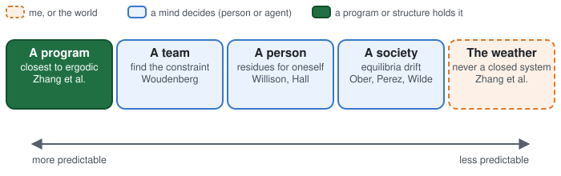

<b>A New Approach to Estimating the Limit of Predictability, Zhang, Toth et al.</b>: no real system is closed

**Wei Zhang, Zoltan Toth, Feifan Zhou, Jie Feng, Malaquias Peña and Ben Kirtman: "A New Approach to Estimating the Limit of Predictability" (*Advances in Atmospheric Sciences*, 2026, [doi:10.1007/s00376-026-5621-8](https://doi.org/10.1007/s00376-026-5621-8))**

Perfect predictability exists only in theory, from outside a deterministic system. Nothing real is closed; we live inside a hyperliminal system and are part of it. Computing systems come closest to ergodic, which is why a program makes a good core and a poor edge.

*From my notes*

> In theory and only from outside of the deterministic system. No such thing exists in the real world. The closest we have is the ergodic behavior of computing systems, but those are limited in their effects.

> The assumption that we're in anything even approaching a closed system, let alone that we fully understand the models is hubris at best and absurdity at worst. We exist in a hyperliminal system, and we ourselves are part of the hyperliminal system. Even if we understood the rest of the environment with incredible detail, we'd need to understand the effects our systems, and therefore our comprehension would have on such a system. There are infinite causal chains here.

*Quotes from the source*

> With a perfect model and initial condition, deterministic systems, by definition, are perfectly predictable forever.

> In reality, incoming solar radiation, however, injects variance with unknown quantum characteristics that act as noise, destroying information first on the smallest scales.

<b>An AI State of the Union, Simon Willison on Lenny's Podcast</b>: residuality for one's own development

**Lenny Rachitsky with Simon Willison: ["An AI State of the Union"](https://www.lennysnewsletter.com/p/an-ai-state-of-the-union), Lenny's Podcast (2026)**

Residuality applies to a person's own development, too. I am not ergodic, but I am more ergodic than the space I live in, so I can build a stable core and keep the edge adaptive.

*From my notes*

> Perhaps residuality theory ought to be applied to one's own development as well. Though, as an individual, you are not ergodic, you are certainly more ergodic than the non-ergodic hyperliminal space that you inhabit. There are two lenses here. Your ergodic system that you interact with and yourself. Both benefit from analysis under this framework because admissibility or adaptability make both thrive better.

*Quotes from the source*

> I'm basically just writing a book about software engineering and what works well and pretending it's about agents, but it's not.

> one of the great misconceptions in AI is that using these tools effectively is easy. It takes a lot of practice and it takes a lot of trying things that didn't work and trying things that did work.

> Anyone who's done any product work knows that your initial idea is always wrong.

> The most valuable skill is being able to adapt to changes, as everything is evolving rapidly.

<b>Why Keeping Your Options Open Is Making You Miserable, JA Westenberg</b>: people are non-ergodic; exploring never stops

**JA Westenberg: ["Why Keeping Your Options Open Is Making You Miserable"](https://www.youtube.com/watch?v=kXqH5ZM3s94)**

"Explore now, exploit forever after" assumes a playbook that repeats. People are non-ergodic: shifting territories of connected parts, not one game replayed. The exploring never stops.

*From my notes*

> This perspective is completely oblivious to the fact that we are non-ergodic systems. We exist not as playbooks incessantly repeated, but as shifting territories of complex, interconnected pieces.

*Quotes from the source*

> The mathematically optimal strategy is Sequential. Explore wildly early on, gather data, keep options open, try many things with low switching costs, and then exploit.

> We trade a real life for the comfort of potential energy.

<b>Democracy and Knowledge, Josiah Ober</b>: equilibria are ideal types; real ones keep moving

**Josiah Ober: [*Democracy and Knowledge: Innovation and Learning in Classical Athens*](https://doi.org/10.1515/9781400828807) (Princeton University Press, 2008)**

How a group gathers knowledge spread across its members, and the reminder that a self-reinforcing equilibrium is an ideal type: nothing real stays balanced without something pushing.

*Quotes from the source*

> An equilibrium may be judged *robust* if it is capable of maintaining coherence in the face of substantial environmental changes.

> more cooperative and (in changing environments) more dynamically adaptive equilibria perform relatively well in economic terms. Less cooperative and inflexible equilibria perform poorly.

> when applied to actual societies, the self-reinforcing equilibrium is another convenient fiction

<b>When the Role Becomes the Self, Kit Perez</b>: when a role becomes identity, feedback breaks

**Kit Perez: ["When the Role Becomes the Self"](https://shepardscale.substack.com/p/when-the-role-becomes-the-self) (The Shepard Scale)**

About people and organizations, not code. Cultures move from alchemy to morality to norms to laws; the hard part is stopping before overreach is systemically enforced and much harder to dismantle. A self tied to one role breaks with the role.

*From my notes*

> A similar parallel is found in the development of cultures. First comes alchemy, then morality, then norms and finally laws. The trouble is stopping the train before restrictive overreach becomes systemically enforced and thus much harder to dismantle.

*Quotes from the source*

> It means the role has migrated from function to identity, and the cost of that migration is being paid by the system and the others in it.

> Eventually *the group itself* may begin selecting for compliance over accuracy at every level

> **A leader who cannot be audited is an unprotected single point of failure, and the whole organization is exposed through it.**

> Drift in language usually precedes drift in decision-making.

<b>Process Surgery, Michael Woudenberg</b>: find the real constraint first

**Michael Woudenberg: ["Process Surgery"](https://www.polymathicbeing.com/p/process-surgery) and ["Maturing Product, Process, and People for Startup Success"](https://www.polymathicbeing.com/p/maturing-product-process-and-people) (Polymathic Being)**

Find the real constraint before fixing anything, and prefer solid basics to a shiny tool.

*From my notes*

> You shouldn't be "maxxing" at all... It's engineering, not theoretical ideology work... Act in context, delineate factors, make compromises and get shit done. Paralysis only kills you.

*Quotes from the source*

> before you dive down to solve a problem, look up and around and make sure you've triaged and diagnosed the patient properly to start with.

> practitioners often fail to look up and around to determine if the problem they are looking at is actually the one that needs to be focused on.

> we also need to be careful to balance the pressure to use the newest and shiny tool when solid basics can quickly and confidently solve the problem.

<b>The Soul of Man Under Socialism, Oscar Wilde</b>: change the conditions, or build a system that survives them

**Oscar Wilde: [*The Soul of Man Under Socialism*](https://en.wikipedia.org/wiki/The_Soul_of_Man_Under_Socialism) (1891)**

One line, and my answer to it. If an idea is not resilient to the present conditions, either change the conditions in a meaningful and sustainable way, or devise a system that can keep operating under them.

*From my notes*

> If an idea isn't resilient in the face of the present conditions, then either: change the conditions in a meaningful and sustainable way (part of the solution, if you ask me) OR devise a system that is able to continue to operate under such conditions, but will not for long, for the incentives and feedback loops keep the system in a desirable homeostasis.

*Quote from the source*

> But it is exactly the existing conditions that one objects to; and any scheme that could accept these conditions is wrong and foolish.

<b>Until You Get Punched in the Face, Cate Hall</b>: charged lessons are too strong and too general

**Cate Hall: ["Until You Get Punched in the Face"](https://usefulfictions.substack.com/p/until-you-get-punched-in-the-face) (Useful Fictions)**

Pattern-matching is adaptive, and a reinforcing loop can make it overfit. A small sample from a charged moment teaches too strong a lesson.

*From my notes*

> I think that synchronicities are a reinforcing feedback loop for adaptive systems' tendencies to over index on the incorrect factors...

*Quotes from the source*

> I consider it one of the central axioms of personal development that the lessons we learn in emotionally charged situations are overly strong and overly general.

> sometimes the small sample size we get when running life's biggest experiments causes us to learn the wrong things, to make too much of insufficient data.

> Once you've really invested in the wrong lesson, it can take years, or a lifetime, to unlearn, unless you make a point of becoming aware of your conditioning.

<b>Industrial Policy for the Intelligence Age, OpenAI</b>: without visibility, no consistent improvement

**OpenAI: ["Industrial Policy for the Intelligence Age: Ideas to Keep People First"](https://cdn.openai.com/pdf/561e7512-253e-424b-9734-ef4098440601/Industrial%20Policy%20for%20the%20Intelligence%20Age.pdf) (2026)**

Without visibility it is very hard to improve anything consistently. The same holds for a country's economy as for a codebase.

*From my notes*

> Vision is everything. Without visibility, it is really hard to make meaningful improvements with any consistency... The current US administration doesn't have good visibility economically...

*Quotes from the source*

> invest in clear, real-time measurement of how AI is affecting work, wages, job quality, and sectoral dynamics

> *Incident reporting.* Establish a mechanism for companies to share information about incidents, misuse, and near-misses with a designated public authority.

> even when full containment is not possible, coordinated action can still meaningfully reduce impact.

## Learning and mastery

Justin Sung's many small lessons, what I know of engrams, the focus on legibility and the habit of reading across fields have made my learning deliberate and cyclical. I learn a system or a project the same way: map the big picture first, attach each new piece to it, return to it on a schedule, and test what I think I know.

Useful flow needs mastery with high conscious comprehension. High articulation with low metacognition comes from better legibility, and from a way of perceiving that lets hypofrontality reach a malleable, near-effortless performance. Flow is not the automatic plateau that deliberate practice avoids; it is what practice makes possible.

Switching does not have to be recovery to be satisfying; recovery and utility are different things. Interleaving is for strengthening memory and for seeding ideas in a well-stocked mind.

### Practice and expertise

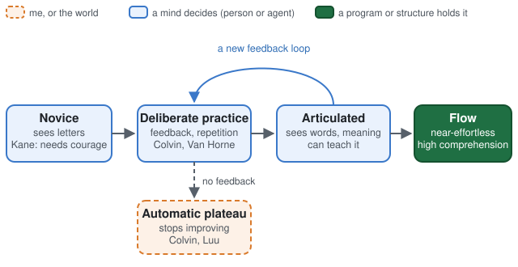

<b>Talent Is Overrated, Geoff Colvin</b>: deliberate practice; iterations, not hours

**Geoff Colvin: [*Talent Is Overrated: What Really Separates World-Class Performers from Everybody Else*](https://www.penguinrandomhouse.com/books/302153/talent-is-overrated-by-geoff-colvin/) (Portfolio, 2008)**

My most annotated book. Expertise is built, and what limits it is not hours but iterations, each with meaning attached. Short feedback loops correct a skill faster. "Just figure it out" is a terrible way to teach; if I cannot teach something succinctly, I do not know it well enough yet.

*From my notes*

> I do not believe it is the time that is the necessity for high performance, but the ideas taught and iterations taken. Things like chess & tennis take so long to get good at because iterations take long to run. When you run chess puzzles, bullet games, vision practices, post game analyses - your skill increases much faster than merely playing games and analyzing them. The shorter feedback loops course corrects the skill quicker. But of course, none of these things are particularly helpful if no meaning/framework is associated with them.

> "Just figure it out" is a terrible way to teach a person. At the very least you should have the humility to say: "I don't know how to put it into words cleanly," and perhaps more importantly: "but I'll give an attempt and emphasize the things you should look for to understand how I operate".

> This is so obvious to me, yet seemingly so absent in my local social graph. How do people operate if not by seeking mechanism? Honestly, I can't stand life unless in pursuit of mechanism.

> One could argue the more that can be condensed into this fission-split form of learning, the better. The map is not the territory, but a really good map can go a long way.

> This is readily apparent in learning a second language. When the mappings from a word go to a meaning, rather than another word - that mapping is quicker to recall and more trivial to utilize in both speaking and comprehending.

> Throw in some AI augmented simulation and high quality review sessions. Suddenly, you've actually gotten much closer to the real thing than most ever will.

*Quotes from the source*

> Deliberate practice is characterized by several elements, each worth examining. It is activity designed specifically to improve performance, often with a teacher's help; it can be repeated a lot; feedback on results is continuously available; it's highly demanding mentally ... and it isn't much fun.

> practicing without feedback is like bowling through a curtain that hangs down to knee level.

> High repetition is the most important difference between deliberate practice of a task and performing the task for real, when it counts.

> A mental model is never finished. Great performers not only possess highly developed mental models, they are also always expanding and revising those models.

> When top-level chess players look at a board, they see words, not letters.

> In the letters-versus-words analogy, it isn't just that novices see letters while experts see words; the experts also know the meanings of the words.

> In general, the knowledge of top performers is integrated and connected to higher-level principles.

> Musicians are much better than nonmusicians at detecting very small differences in pitch and loudness of notes. Everyone in these studies is hearing the same things, but through years of practice, some are perceiving more.

> Metacognition is important because situations change as they play out.

> These must be self-evaluations; because the practice activities took place in our own minds, only we can know fully what we were attempting or judge how it turned out.

> Occasionally people actually get worse with experience.

> IQ is a decent predictor of performance on an unfamiliar task, but once a person has been at a job for a few years, IQ predicts little or nothing about performance.

> Innovation doesn't reject the past; on the contrary, it relies heavily on the past and comes most readily to those who've mastered the domain as it exists.

> But in the great majority of careers, and in the advanced stages of all of them, there is no published curriculum, no syllabus of materials that must be studied and mastered.

> Most organizations are terrible at applying the principles of great performance.

<b>Mastery Starts With Mechanics, Patrick Van Horne</b>: the why is part of the mechanism

**Patrick Van Horne: ["Mastery Starts With Mechanics"](https://www.cp-journal.com/p/left-of-bang-briefing-74) (CP Journal)**

The why is part of the mechanism. Repetition cannot be skipped, but it can be shortened: start with mechanism and reasoning, practice, then keep returning to the reasoning where a rule was misapplied.

*From my notes*

> The *why is part of the mechanism*. It's the internal state of affairs that lead to effective utilization of the side effects. To omit them and let people learn them on their own as the only mode of operation is short sighted.

> While it's true that you can't get around hard work and repetition, I believe the periods of repetition can be sped up substantially.

*Quotes from the source*

> the people who consistently get ahead of events are rarely guessing. They are just applying skills that have been practiced so thoroughly that they appear effortless from the outside.

> What looks like intuition is often mastery at work.

<b>Experts Have It Easy, Boyd Kane</b>: expert intuition is formidable but rarely explained

**Boyd Kane: ["Experts Have It Easy"](https://boydkane.com/essays/experts)**

An expert who cannot explain their choices is somewhere in the middle, not at the end. Unconscious skill is real, but it plateaus when it is the only way of knowing.

*From my notes*

> I would argue that's not true expertise, that's somewhere in the middle. Being able to articulate oneself is an important skill for teaching and skillful action. Flow state and deliberate practice are activities engaged with high degrees of intentionality. It's not to say that unconscious cognition is invalid, it's just less sophisticated, and you will plateau if that is your only mechanism of mastery and comprehension.

*Quotes from the source*

> The expert's intuition is often formidable, but rarely comprehensible.

> Often there's an underlying pattern that the novice can pick up through careful observation, even if neither the expert nor the novice can properly articulate this pattern.

> the novice needs courage (to make decisions without knowing the consequences) and confidence (so that they whole-heartedly commit to their decisions and grant them the greatest chance of success).

> But the niche things require active study, and ignoring the niches is how you remain a novice.

> They cannot just "check their work for mistakes", because for any substantial body of work the Novice likely wouldn't be able to point out half their decisions.

<b>95%-ile Isn't That Good, Dan Luu</b>: few people practice on purpose

**Dan Luu: ["95%-ile Isn't That Good"](https://danluu.com/p95-skill/)**

Few people try hard to improve, so focused practice moves you far in percentile terms. I would rather name the specific failure mode than call someone untalented.

*From my notes*

> "untalented" is such a lazy method of describing lack of skill. There are a million more specific ways to describe failure modes.

> Become the shark, or find a smaller pond

*Quotes from the source*

> Relatively few people obsessively try to improve and figure out what works, which results in a lack of rigorous curricula for improving.

> a skilled coach is someone who is skilled at coaching, not necessarily someone who is skilled at the activity.

### Memory, attention and the brain

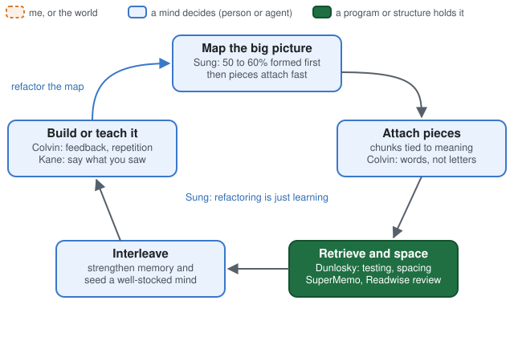

<b>Learning talks, Justin Sung</b>: big picture first; organizing is the learning

**Justin Sung: talks and coaching sessions on YouTube, including ["How to Learn and Retain High Volumes of Information"](https://www.youtube.com/watch?v=D95rCKo8vac), ["How to READ So That You ACTUALLY RETAIN Information"](https://www.youtube.com/watch?v=EyOEB0EoIP8) and ["How to Think Like a Strategic Genius"](https://www.youtube.com/watch?v=XNzRIlcsOEQ)**

The most practical source here. Build the big picture first and new pieces attach fast; anything isolated becomes learning debt. Organizing the material is where the learning happens, so the effort is the point. This shapes the teaching moments in the build loop and how I read a new codebase.

*From my notes*

> Refactoring is just learning. To refactor knowledge is humble and effective. To refactor code is largely the same process. Most people try to start with the details and exclude the design process. This misses a key detail and forces you to learn about the problem space slower. Learn all the high level components and make guesses about how they're made to fit. Basically, group early and reshape your mental model (mind maps are great!) often.

> Compilers assist learning. How can we bring a compiler into other varieties of thought?

> Perhaps there's something to be had here about choosing halfway skills to learn. So that you're always operating at 40-60% comprehension. The question is how. How does one do this?

> I think this is achieved by first struggling to craft a wide net of general concepts that you then can quickly lattice onto new knowledge. Biology and cognition plays a role, but knowledge likely plays a larger one. You too, can experience the one-shot grasp... Everything just needs to be within reach first. What this media misses is that people like that have wide nets.

*Quotes from the source*

> once you have a big picture that's relatively formed, fifty to sixty percent formed, new pieces are much faster to add in because you have so much more referential data in your brain. And that's what snowballing means.

> Anything that's isolated is becoming learning debt

> it is the process of trying to organize it that creates the learning. It is not the end product that matters.

> If you struggle with mapping things out and seeing how it all fits together, it means it's not organized in your brain.

> We have to understand that when we feel that we're learning something, it should feel, in the first phase, fairly overwhelming.

> So if you don't feel that it's cognitively engaging, that's a red flag.

> So where we want to end up is inside this Goldilocks zone, where we are using a strategy that allows that load to go down, and then we are allowing that load to raise up again

> you're getting beyond sort of six different elements floating around at the same time. You're probably not in a cognitively optimal state anymore.

> Just turn that existing task into a retrieval opportunity.

> It's not having to create new connections from scratch. It's leveraging off existing connections from your nearest neighbor. An example of this in practice is actually just creating analogies.

> Hickam's dictum says verbatim, patients can have as many diseases as they damn well please. It states that reality doesn't owe it to you to be simple.

> So learning is earning

<b>Improving Students' Learning With Effective Learning Techniques, Dunlosky et al.</b>: testing and spacing work; highlighting alone does not

**John Dunlosky, Katherine A. Rawson, Elizabeth J. Marsh, Mitchell J. Nathan and Daniel T. Willingham: "Improving Students' Learning With Effective Learning Techniques" (*Psychological Science in the Public Interest*, 2013, [doi:10.1177/1529100612453266](https://doi.org/10.1177/1529100612453266))**

The evidence behind the retrieval and spacing habits, and a warning that highlighting alone does little. A highlight is only worth something when it feeds retrieval, which is what Readwise's review is for.

*From my notes*

> Ease is not the same as quality.

> Note that interleaving received a higher score. Highlighting and rereading alone may not provide high value. However, combined with spaced repetition, I suspect otherwise.

*Quotes from the source*

> Practice testing and distributed practice received high utility assessments

> Elaborative interrogation, self-explanation, and interleaved practice received moderate utility assessments.

> Five techniques received a low utility assessment: summarization, highlighting, the keyword mnemonic, imagery use for text learning, and rereading.

<b>Incremental Learning, SuperMemo</b>: incremental reading, many texts at once

**SuperMemo: ["Incremental Learning"](https://help.supermemo.org/wiki/Incremental_learning)**

Reading many texts in small portions, delinearized and scheduled, is how I keep a polymathic reading list moving. Readwise and Reader are my version of it.

*Quotes from the source*

> Incremental reading is a learning technique that makes it possible to read thousands of articles at the same time without getting lost.

> In the same way in which the web helped delinearize the global sources of information, SuperMemo can help you delinearize your reading

> if the article tends to make you bored, stop reading. Your attention span is always limited.

> In incremental reading, you read articles in small portions.

> once you master incremental learning, it can truly be the best part of your day

<b>Here Is Your Brain essays, Juliette Ryan</b>: the neuroscience under the habits

**Juliette Ryan: essays on [Here Is Your Brain](https://hereisyourbrain.substack.com/), including ["You Think You're Learning When You Read. Only 4% Do."](https://hereisyourbrain.substack.com/p/you-think-youre-learning-when-you), ["From Surprise to Craving"](https://hereisyourbrain.substack.com/p/how-a-dopamine-spike-shifts-backwards), ["What Kind of Brain Are You Building?"](https://hereisyourbrain.substack.com/p/what-kind-of-brain-are-you-building) and ["You're Not as Focused as You Think"](https://hereisyourbrain.substack.com/p/your-focus-is-being-drained)**

The neuroscience under the learning habits: situation models, working memory, dopamine and plasticity. I disagree with her on one point: not every second brain costs working memory. How notes are made and reached decides that.

*From my notes*

> I'd argue that not all forms of second brain suffer from this flaw. Some, surely. But the creation and access method surely can assuage this problem.

> I cannot help but wonder how interleaving content plays a role here and whether certain types of content switching are as detrimental as others.

> This is the same mechanism that leads to learning the lyrics of songs I think

*Quotes from the source*

> Psychologists call this stage a situation model (van Dijk & Kintsch 1983). We construct it along several dimensions at once (time, place, character, cause etc.) while we read.

> There is an average probability of about 15 percent of learning an unknown word from a single context exposure during normal reading

> Anything you have to look up in a "second brain" takes up precious slots of working memory, which leaves fewer for anything else.

> The dlPFC can maintain approximately 4±1 items in working memory, often described as "chunks" of information

> You can be "thinking" (task PFC active) without "observing your thinking" (metacognitive PFC active).

> when a low-value stimulus is continually suppressed below conscious awareness, silently draining our resources, prematurely fatiguing our cognition.

> If you feel flat and empty when you stop, that's a sign the limbic signal was too loud; you were in passive consumption mode, not active learning.

> you were *using* your brain rather than being used *by* it.

> The "feed" is **pursuit without an end goal**, **consumption** without a disappearing **reward**.

> So when a spike occurs, our brain can essentially **look back into the past 30 seconds** and search for clues.

<b>Flow Radio, Flow Research Collective</b>: flow and intuition can be trained

**[Flow Research Collective](https://www.flowresearchcollective.com/): Flow Radio episodes, including "Gut Instinct, Hard Science: The New Neuroscience of Intuition" and "Flow vs. The Victim Mindset"**

Flow and intuition as trainable states, and the brain as a prediction engine. Intuition is a fast go or no-go signal; analysis guides the longer goals. Treating intuition as a source of truth is where it goes wrong.

*From my notes*

> All too often this intuitive signal ends up bundled as a religious source of truth and as a god tulpa... in simple cases leading to prejudice and bad decision-making, and in extreme cases leading to disastrous outcomes both for the individual and those around them. The more self-awareness a person has, the less this particular folly of the mind has hold over them.

*Quotes from the source*

> the edge of criticality is right at the edge of chaos. There's maximum complication in the system, so the greatest possibility for discovery.

> Brains evolved to move our bodies to uncertain environments, and predicting what happens next is absolutely fundamental to movement and by extension cognition.

> Unsolved problems are stored as attractors and basins of attraction in the brain, influencing future learning and problem-solving by drawing in related inputs.

> Flow serves as a trigger for intuition.

> Strong intuitions related to basic needs like sex, hunger, or safety are more prone to error

> Impostor syndrome can be a healthy motivator when viewed as a signal to acquire necessary skills and knowledge

### Reading widely

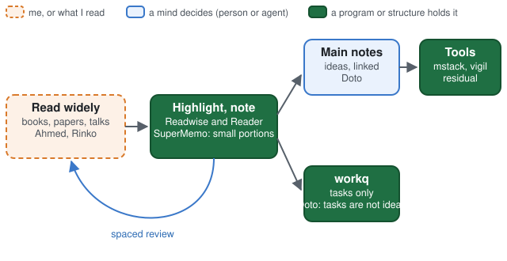

<b>The Polymath, Waqas Ahmed</b>: I refuse to specialize

**Waqas Ahmed: [*The Polymath: Unlocking the Power of Human Versatility*](https://en.wikipedia.org/wiki/The_Polymath) (Wiley, 2019)**

I refuse to specialize. I am not against depth; I am against shutting out interests for the sake of looking simple. Many of the ideas in mstack came from fields that have nothing to do with code.

*From my notes*

> There is some truth that switching can provide value, but having active recovery periods (as short as 2m, up to 20m in most cases) greatly enhances individual performance and flow proneness.

*Quotes from the source*

> the best of the polymaths demonstrate the ability to do both simultaneously. They tend not to see *universality* and *particularity* as a dichotomy, but instead as complimentary outlooks

> species with a wider range of capacities and better flexibility are able to adapt, while narrow-focused specialists, faced with little or no option, become vulnerable to extinction.

> the way to truth is to gather together many, many perspectives, from which will emerge a common core

> The most important thing is never to make a decision about yourself that limits your options.

> 'Human beings are works in progress that mistakenly think they're finished.'

> Disciplines morph, shape and take their character as ideas and knowledge evolve ... they are connected in all sorts of ways that children are currently discouraged from seeing. (Ken Robinson)

> Experts who have acquired their knowledge at great personal cost often resent or resist ideas brought by newcomers.

> Self-learning (or 'autodidactism') is a viable, some may say preferable, avenue for the prospective polymath.

> It is a space where, to quote science writer Matt Ridley, 'ideas have sex.'

<b>Self-education essays, Sam Rinko</b>: a generative reading plan; a well-stocked mind

**Sam Rinko: essays on [self-education](https://samuelrinko.substack.com/), including ["Why I Built a Mastery Subject Reading Plan"](https://samuelrinko.substack.com/p/why-i-built-a-mastery-subject-reading), ["The Secret to Creativity: A Well-Stocked Mind?"](https://samuelrinko.substack.com/p/the-secret-to-creativity-a-well-stocked) and ["Why 'Only Learn What You Can Monetize' Is a Stupid Idea"](https://samuelrinko.substack.com/p/why-only-learn-what-you-can-monetize)**

A reading plan that is generative, and the case for a well-stocked mind. I would not limit the sampling to the start: to outdo the specialist, keep being a generalist.

*From my notes*

> There isn't a real reason to ever stop sampling and growing. Of course, having mainstays is crucial, but so is avoiding stagnation. To surpass the specialist, one must remain a generalist.

> Conversely, I find that varying one's internal direction allows unexpected insights to become clearly visible.

*Quotes from the source*

> The reading plan, when you apply your creativity and powers of reflection to it, is generative. It results in new creations and behaviors that help you make a difference in the world.

> With a question in mind, your reading also improves. With a reference point, you are better able to understand the meaning of material and see how it all connects.

> Stock is also the material you weave together to create your unique perspective about the world

> By exposing you to several different ideas, subjects, and authors in one sitting, book scrolling creates opportunities for original creative association.

> The most interesting person in the room is usually also the most interested person in the room.

> "You must be able to say, with reasonable certainty, 'I understand,' before you can say 'I agree,' or 'I disagree,' or 'I suspend judgment.'" (Mortimer Adler, quoted by Rinko)

<b>A System for Writing, Bob Doto</b>: capture everything; tasks are not ideas

**Bob Doto: [*A System for Writing*](https://bobdoto.computer/) (2024)**

Capture everything, process it later, and keep tasks out of the notes. Tasks are not ideas; they are why my earlier note systems filled with deferred work, and why workq lives apart from my notes.

*From my notes*

> My newest attempt at getting it to work will not include tasks. I think Bob Doto is on to something here.

> Readwise Reader has systematically provided me with this and it's great. On further reflection... perhaps not entirely. Much of the process is embedded in my RW process, but not all of it. The conversion to main notes step is absent. At least, in any sort of systemized, habitual manner.

*Quotes from the source*

> Not writing ideas down, because you think you'll remember them later, is not a dependable system.

> Fleeting notes containing tasks (Fig. 4) will never become main notes, because tasks are not ideas.

> Contrary to what some believe, "Luhmann did not excerpt directly into the box while reading, but only created the notes in a second step based on his reading notes"

### Choices and craft

<b>Nudge, Richard Thaler and Cass Sunstein</b>: defaults decide most outcomes

**Richard H. Thaler and Cass R. Sunstein: [*Nudge: Improving Decisions About Health, Wealth, and Happiness*](https://en.wikipedia.org/wiki/Nudge_(book)) (Yale University Press, 2008)**

Defaults and choice architecture decide most outcomes, for people and, I suspect, for models. A tool's defaults are a design decision with that weight.

*From my notes*

> Is this truly different from an LLM?

> This complements nicely the observation in *Talent Is Overrated* thatprofessionals with more complicated mental models tend to do better than those with simpler ones. They're swayed more by the environment than by their own nuanced conviction.

*Quotes from the source*

> Humans make mistakes. A well-designed system expects its users to err and is as forgiving as possible.

> In a cafeteria, it is impossible to avoid some way of organizing food.

> you want the signal you receive (the stimulus) to be consistent with the desired action. When there are inconsistencies, performance suffers and people blunder.

> Leaving the gas cap behind is a special kind of predictable error psychologists call a "postcompletion" error.

> if you dig a channel for them to slide down that removes the seemingly tiny barriers that are getting in their way, the results can be quite dramatic.

> The nozzles that deliver diesel fuel are too large to fit into the opening on cars that use gasoline

> an arbitrary "tradition," in the form of some judgment about the distance, can become entrenched over time, so that many people follow it notwithstanding its original arbitrariness.

> when people conform in Asch-like settings, they actually see the situation as everyone else does.

> Freedom to choose is the best safeguard against bad choice architecture.

> rare, difficult choices are good candidates for nudges.

<b>Against Taste, Will Manidis</b>: mastery comes before effortlessness

**Will Manidis: ["Against Taste"](https://x.com/willmanidis/status/2023866928608002183) (2026)**

Mastery comes before the effortlessness worth having. Where I part ways: a remix can aim high, and when someone got most of the way, building on it is not a loss of integrity. His Sistine Chapel passage reads to me like a good pairing between an engineer and an agent: shared understanding with each other and with the work.

*From my notes*

> I think it very poignant to state that mastery precedes the worthwhile effortlessness. But I would like to point out that the timescale which you'd like something to exist over is a relevant factor in how much you dedicate. This is present in learning, investing, purchasing tools, and in all forms of generative acts. The Sistine Chapel still stands because their timescale was that "of God's". I think it worthwhile to note that not everything ought to exist on such timescales. Some things are preferable at the "works OK enough" level. Because to get them right would require investment that isn't worth it.

> Sometimes someone else got 60%+ of the things right and it would be wasteful to not use that as a starting point. This doesn't apply to everything, but if the item is mass manufactured or replicable (i.e. digital) then it applies. Don't go and vandalize a Bob Ross and say "he got 80% there" of course, but do go and refactor that SVG!

> As I continue to reread this piece, I am struck by a strange sense of familiarity with the way that AI code generation and software engineers can pair together. I've also made the observation that it's not necessarily about divination, in these cases, but rather about a shared understanding and a sort of alignment that is central to the two or more parties involved in the creation act. A localized culture or relationship as one could put it.

*Quotes from the source*

> The thing that produced the *Rite* was not taste. It was Diaghilev in the rehearsal room, fighting, provoking, demanding something that no existing taste could have specified.

> The ceiling exists because two difficult men were locked in a conversation with a transcendent third who could not speak back to them, and neither could have produced it alone.

> The disregard of someone who has internalized the rules so much that he can feel where they bend, where they want to break, where the new thing is hiding inside the old one.

> Machines will learn your taste. They will internalize your preferences. They will anticipate your selections faster than you can make them.

> For most of human history there was no concept of taste as we understand it. There was patronage.

> The remix can be beautiful. But it cannot produce the rapturous, the transcendent

## People and agents

Personas are not personalities. A persona is closer to a caricature: a role meant to shift a model's train of thought toward a useful distribution for the task at hand. What I want from an agent is specific, predictable, useful behavior, and memory in service of it.

### Assistants and interfaces

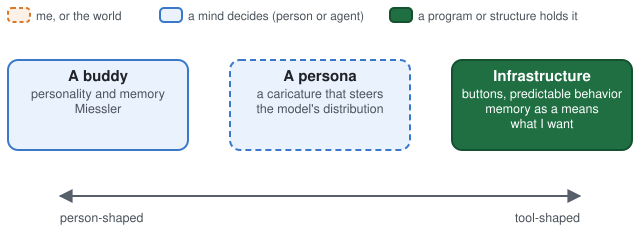

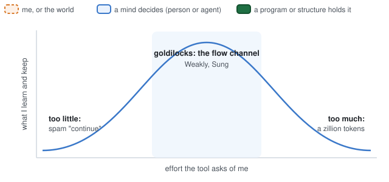

<b>We're All Building a Single Digital Assistant, Daniel Miessler</b>: I want infrastructure, not a buddy

**Daniel Miessler: ["We're All Building a Single Digital Assistant"](https://danielmiessler.com/blog/we-are-all-building-single-digital-assistant)**

I disagree with most of it, and that is why it matters. Why must the assistant be person-shaped? I want magical infrastructure, not an omnipotent buddy, and I love my buttons. I do not want an automated friend. I want to be pushed and to grow: mild, persistent discomfort with brief periods of calm, the way flow feels.

*From my notes*

> Why an army? Why not a clever memoization oracle that is guided by a persistent agent..?

> I don't get this... Why? Why must it be person shaped? I want my DA to be magical infrastructure... Not an omnipotent buddy. Omnipotent (ish) infrastructure.

> I don't want memory so I can have an automated friend. I want to be pushed. I want to grow. I want persistent, mild discomfort with brief periods of calm from the system. Is it uncomfortable? Yes. But flow is amazing, and doing, being, achieving is amazing.

> Again, why must the interface be person shaped? I for one love my buttons! Not that natural language shouldn't be an option... But the primary interface? IDK... feels off to me

*Quotes from the source*

> And because we are humans, we want that to be someone with a personality and a memory.

> Guess what can do it? A whole army of agents.

> *We speak, things happen. We gesture, things happen. We text, things happen. No need to find, understand, or master new tech.*

> My concept here is that the principal is at the center of the whole system.

> the best way to think about this is to imagine all that stuff abstracted away.

<b>Stop Building AI Tools Backwards, Hazel Weakly</b>: a tool should take the right amount of effort

**Hazel Weakly: ["Stop Building AI Tools Backwards"](https://hazelweakly.me/blog/stop-building-ai-tools-backwards/)**

A tool should take the right amount of effort. That is flow's skill-challenge balance, explore and exploit, and working memory limits, applied to tool design.

*From my notes*

> Flow state! Skill-challenge-balance! Explore / exploit! Miller's Law and optimal learning!

*Quotes from the source*

> Processes need to take a goldilocks amount of effort to be effective

> humans don't really learn when we download info into our brain, we learn when we *expend effort* to pull that info out.

> Don't just keep humans in the loop, remember that humans *are* the loop.

> AI should be an amplifier, not an obfuscater.

> *Never* go from blank to outcome

> if you give someone a "continue" button, or a generic "provide next hint/step/action" button, they will probably learn to just spam the button

> Humans learn collectively and innovate collectively via copying, mimicry, and iteration on top of prior art.

<b>The Real Computer Revolution Hasn't Happened Yet, Alan Kay</b>: let beginners act as intermediates

**Alan Kay: ["The Real Computer Revolution Hasn't Happened Yet"](https://www.vpri.org/pdf/m2007007a_revolution.pdf) (Viewpoints Research Institute, 2007)**

Representations that let beginners do the real thing are the point of a learning interface. Paneweft and the mock-up views aim at the same thing for code.

*Quotes from the source*

> The rule of thumb here is to find ideas and representations that allow "beginners to act as intermediates", that is, for learners to immediately start doing the actual activity in some real form.

> The most important principles in early children's learning are to try to find out what they can do, what representations of ideas work best for them, and what kind of social environment triggers their built-in urges to get competent

> This simple scheme of "try something, test, keep going if OK, do something random if not" is found in most living creatures from bacteria on up

> schooling requires them to get exact rather than real answers

> the remedy is not to take it from them, but to increase their discretion by education. (Thomas Jefferson, quoted by Kay)

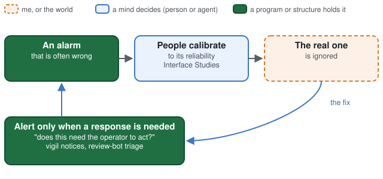

<b>The Lost Discipline of the Alarm, Interface Studies</b>: an alarm that is usually wrong gets ignored

**Interface Studies: ["The Lost Discipline of the Alarm: What Notification Design Forgot"](https://www.youtube.com/watch?v=Ira28fgSF7M) and ["When Software Took the Word 'Social'"](https://www.youtube.com/watch?v=j7xidb5fK8c)**

An alarm that is usually wrong trains people to ignore it. This is why vigil's notices are rare and one-time, and why a review bot that cries wolf gets triaged before anyone reads it.

*Quotes from the source*

> Alarm fatigue is not a discipline problem in the human. It is a credibility problem in the machine itself.

> people calibrate to reliability. An alarm that is usually wrong trains everyone near it to respond as rarely as it is right.

> does this need the operator to do something? It is not 'might they like to know,' but does it actually require a response?

> He argued in 1991 that computing would dissolve into the environment, and with John Seely Brown, they both wrote Designing Calm Technology in 1995.

<b>Design Is Search, Karri Saarinen</b>: design is search; code is commitment

**Karri Saarinen: ["Design Is Search"](https://x.com/karrisaarinen/status/1999730838280503775)**

Mock-ups come before code because code is a medium of commitment. The search phase is where the outcomes nobody expected are found.

*Quotes from the source*

> Code is a medium of commitment. Designing inside an existing system means inheriting its past decisions.

> Early design needs freedom. Later design needs reality.

> If you let constraints define the space too early, you do not just get a worse outcome. You lose outcomes that never get discovered.

> Tools raise the floor, but they can also lower the ceiling if they quietly define what is worth attempting.

> The design process, and the suffering part of that process, are valuable.

<b>My notes on Talent Is Overrated</b>: a tennis-reading game; reading ahead

**Ideas from my notes on *Talent Is Overrated***

Two passages from Colvin turned into interface ideas. Tennis players read a serve from the opponent's body, so I sketched a training game: easy mode color-codes and exaggerates the movement, medium removes the color, hard makes it subtle, and coaching points out the cues as you play. Typists slow to a novice's pace when they cannot see ahead, which made me ask what reading interfaces such as RSVP lose and what they could give back.

*From my notes*

> In fact, I just got a good idea for a video game to accelerate tennis performance! Based on a model incorporating this finding and others, a game could have 3+ modes: easy, medium, hard, etc. Easy would color code and use very exaggerated movements, medium would remove the color coding and make the movements slightly subtler, and hard would make the movements truly subtle. During the course of play, coaching would point these things out. Then, once a player gets the mechanics here, harder modes would involve deliberate obfuscation techniques. This would rapidly develop a tennis player's game vision. Then, from there the kinematics could be taught and the players would be in good shape.

> I wonder what implications this has for speed reading... Does RSVP work if a person uses a different mechanism to reach faster reading speeds? It's certainly possible that a person can read faster by looking ahead in the text... I've read about saccades and suspect it's possible to expand one's ability to read faster. However, information processing speed and optical recognition timescales make me less certain that major improvements w/o radical changes are possible. Perhaps using emojis could lead to an acceleration? Trouble is, the concepts emojis tend to express aren't always super relevant to the text being read and many emojis are hard to distinguish at smaller scales. I could certainly experiment with this by using a limited subset and RSVP.

*Quotes from the source*

> When researchers prevented top typists from looking farther ahead in the text, they performed scarcely better than novices.

> Yet you probably won't be able to do much with that information the next time you're on the court because you haven't spent hundreds of hours learning how to read the subtle movements of your opponent's hips, shoulders

### Truth, trust and thinking with machines

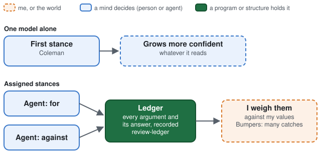

<b>Truth-Seeking and Critical Thinking in the Age of AI, John Coleman</b>: deliberation needs assigned stances

**John Coleman: ["How We're Ensuring Truth-Seeking and Critical Thinking in the Age of AI"](https://eternallyradicalidea.com/p/how-were-ensuring-truth-seeking-and)**

A model that grows more confident in its first stance no matter what it reads cannot deliberate alone. Deliberation needs several agents, each building the argument for an assigned stance, weighed against the asker's values and against other lenses. The review rounds in the build loop argue in this way.

*From my notes*

> This is where dedicated tools and harnesses designed for true deliberation will come in handy. The tools mentioned here will be useful in fine-tuning individual arguers, however, you still need a multi-agent approach where each is surveying and constructing logical arguments for their own predefined stances. Then each must be weighted according to how it aligns with the values and priors of the individual proposing the question.

*Quote from the source*

> Instead, the model steadily grows more confident in their initial stance, regardless of what information they encounter. That's a major problem because the model *looks* like it's thinking and reasoning, but its conclusions are effectively locked in from the start.

<b>The Future of Everything Is Lies, I Guess, Kyle Kingsbury</b>: a bleak survey, read against my own use

**Kyle Kingsbury: ["The Future of Everything Is Lies, I Guess"](https://aphyr.com/posts/411-the-future-of-everything-is-lies-i-guess) (2026)**

A sharp, bleak survey I read against my own use. Many of its failures come from using the tool for what it cannot yet do. Know its capabilities, give it the right context, and know which context rots. I would also not rule out early signs of metacognition.

*From my notes*

> There's something to be said here about misusing this tool. They will not complete tasks fully autonomously. The balance is knowing what they actually can do, how to give them the correct context, what they can't do, and what kind of context serves as rot.

> In many cases, that is correct, however, there have been some signs of early metacognition with artificial intelligence systems, and I would not discount that.

*Quotes from the source*

> I think ML models will further diffuse responsibility, replacing judgements that used to be made by specific people with illegible, difficult-to-fix machines for which no one is directly responsible.

> Since we tend to look at computer systems as rational arbiters of truth, ML systems wrap biased decisions with a veneer of statistical objectivity.

> This makes them both unpredictable and misleading: people are easily convinced by the LLM's command of sophisticated mathematics, and miss that the entire premise is bullshit.

> In LLMs, chaos arises from small perturbations to the input tokens.

> In chaotic systems, even though the specific path taken is unpredictable, attractors evince recurrent structure.

> intensive reading declined in favor of comparative reading.

> the space of possible futures feels much broader in 2026 than it did in 2022, and most of those futures feel bad.

> "You're absolutely right, Senator. I *did* embezzle those sixty-five million dollars. Here's the breakdown…"

<b>Putting Up Bumpers, Anthropic</b>: many independent catches

**Anthropic: ["Putting Up Bumpers"](https://alignment.anthropic.com/2025/bumpers/) (Alignment Science blog, 2025)**

Many independent ways of catching and correcting a failure, which is how I build checks around agents. "Redundant" undersells them: on a problem this critical, no two are truly redundant.

*From my notes*

> I would argue that these methods are not in fact truly redundant. At first glance, they may seem so, but due to the critical nature of this, they are not, in fact, redundant to multiple degrees. I think the point is argued well in the article, but calling them redundant, feels reductive.

> What is this but theory based on limited evidence and speculation? Granted, I don't have anything better... but this still scares me.

*Quotes from the source*

> Our challenge, on the Bumpers view, is to build many redundant ways of catching and correcting this when it occurs.

> If these researchers fail, though, this gives only indirect and contingent positive evidence for safety, since the space of possible misaligned models is large.

> it's still necessary that the competitive and regulatory landscape allows developers to take however much time is needed to make early AGI systems demonstrably safe.

<b>The Impact of Generative AI on Critical Thinking, Lee et al.</b>: practice keeps critical thinking; hand-off loses it

**Hao-Ping Lee et al.: "The Impact of Generative AI on Critical Thinking" (CHI 2025, [doi:10.1145/3706598.3713778](https://doi.org/10.1145/3706598.3713778))**

People who treat AI work as practice keep thinking critically; people who hand it off stop. I also doubt critical thinking is as hard to self-observe as the paper says; introspection about it improves with practice.

*From my notes*

> I am skeptical of this being true for all levels of critical thinking. I believe as a person becomes more accustomed and practiced with critical thinking, their introspective capabilities surrounding it increase.

*Quotes from the source*

> while AI can improve efficiency, it may also reduce critical engagement, particularly in routine or lower-stakes tasks in which users simply rely on AI

> participants shared examples when they perceived more effort in information retrieval because the **AI response can be wrong and needs verification**

> because critical thinking itself as a pure mental phenomenon is difficult for people to self-observe, reflect on, and report.

<b>Why Do People Believe True Things?, Dan Williams</b>: truth is not self-evident

**Dan Williams: ["Why Do People Believe True Things?"](https://www.conspicuouscognition.com/p/why-do-people-believe-true-things) (Conspicuous Cognition)**

Truth is not self-evident, and the norm of justifying beliefs is rare. Many institutions think they are institutions of truth without having earned it.

*From my notes*

> From what I can see, many don't even realize this. They think they're institutions of truth, which is a sad and destructive belief...

*Quotes from the source*

> "The truth about distant or complex matters," writes Walter Lippmann, "is not self-evident."

> For most people in most places, there is little embarrassment in the fact that their worldview, religion, or ideology are designed not for truth but for things like identity formation

> to organise all that socially acquired information, you relied on simplifying categories, schema, and explanatory models that reduce reality's complexity to a tractable, low-resolution mental model.

> It is easy to achieve poverty. ... the genuinely puzzling economic question concerns the origins of wealth, not poverty.

